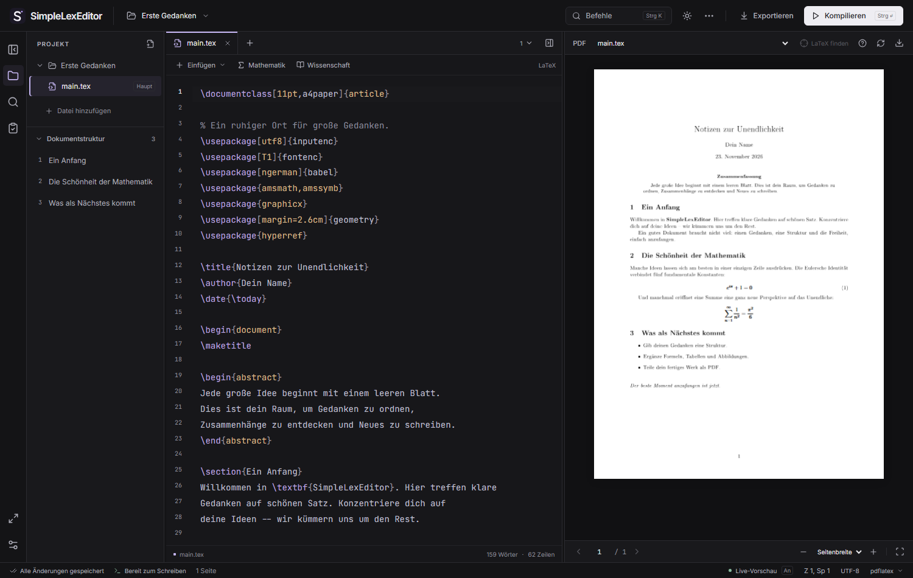

# SimpleLexEditor

**Lokaler LaTeX-Editor für Windows.** Bearbeite mehrteilige Projekte mit PDF-Live-Vorschau direkt neben dem Quellcode.

[Ausprobieren](#ausprobieren) · [Handbuch](docs/USER_GUIDE.md) · [Mitwirken](CONTRIBUTING.md)



[Helle Ansicht ansehen](docs/screenshots/light.png)

## Ausprobieren

### Browser-Demo

Starte die Demo mit einer aktuellen Version von Node.js 22 oder 24 aus dem Projektordner.

```powershell
npm ci
npm run dev
```

Die Demo öffnet „Erste Gedanken“ mit einer fertigen Beispiel-PDF. Änderungen speichert sie im Browser. [Lokale Demo öffnen](http://127.0.0.1:1420).

### Windows-App

Unter Windows 10 und 11 (x64) öffnet SimpleLexEditor Projektordner und kompiliert LaTeX mit einer lokalen TeX-Installation. [Desktop-App aus dem Quellcode starten](CONTRIBUTING.md#desktop-app-starten).

Für ein eigenständiges Windows-Paket lässt sich ein Offline-Installer mit TeX Live und WebView2 bauen. [Installer bauen und prüfen](docs/RELEASE.md).

## Funktionen

- **Projektarbeit** mit Dateibaum, projektweiter Suche und Versionsverlauf. [Beispielprojekt ansehen](examples/erste-gedanken/).
- **Mathematik** mit visuellem Editor für verschachtelte Formeln, Matrix-Editor und Symbolsuche. [Formeleditor ansehen](docs/screenshots/mathematik.png).
- **Wissenschaftliches Schreiben** mit BibTeX-Import, Zitaten mit Seitenangaben und einem Index für Gleichungen, Aussagen und Abbildungen. [Wissenschaftlicher Arbeitsbereich](docs/SCIENTIFIC_WORKSPACE.md).
- **Compilerhilfe** mit Sprüngen zur betroffenen Quellzeile und Korrekturvorschlägen für häufige Fehler. [Compilerhilfe lesen](docs/COMPILER_HELP.md).

## Mitwirken

Fehlerberichte, Vorschläge und Pull Requests sind willkommen. [Entwicklung einrichten und Änderungen einreichen](CONTRIBUTING.md).

## Lizenz

Der Quellcode von SimpleLexEditor steht unter der MIT-Lizenz. [Lizenztext](LICENSE).

Für eingebundene Komponenten gelten die in den Drittanbieterhinweisen genannten Lizenzen. [THIRD_PARTY_NOTICES.txt](THIRD_PARTY_NOTICES.txt).
