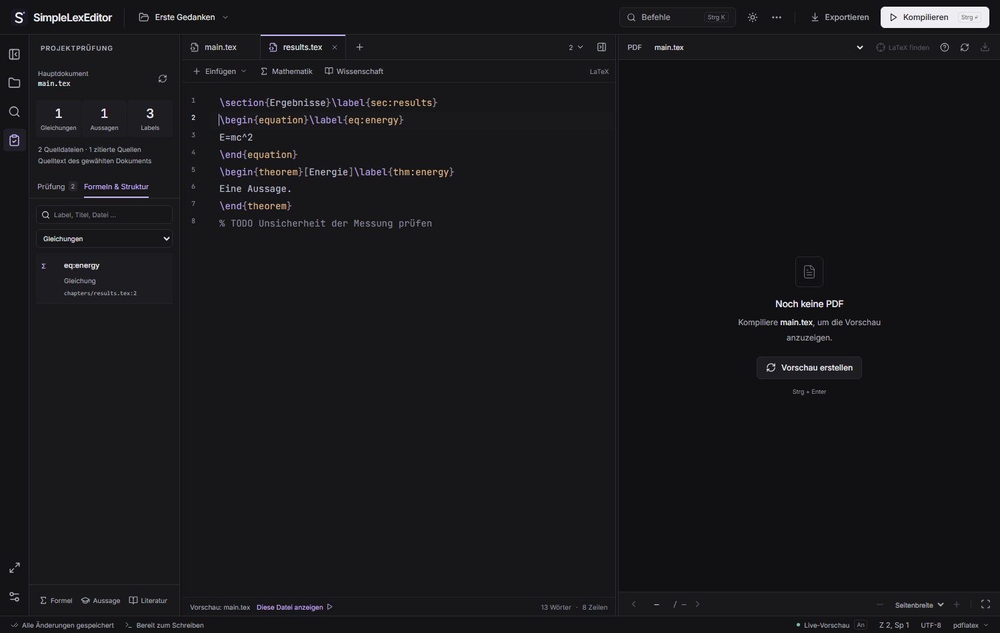

# Wissenschaftlicher Arbeitsbereich · SimpleLexEditor 1.6

## Formeln visuell zusammensetzen

**Mathematik** oder **Strg+M** öffnet den Formeleditor. Wähle einen Baustein, klicke in eines seiner Kästchen und tippe den Inhalt. An jeder Position kannst du einen weiteren Baustein einsetzen: etwa eine Wurzel im Zähler oder einen Bruch innerhalb eines Integrals. Markierte Teilausdrücke werden in den gewählten Baustein eingebettet.

Die häufigsten Strukturen sind direkt sichtbar; **Weitere Bausteine** enthält unter anderem Ableitungen, Vektoren, Matrizen und Fallunterscheidungen. Pfeiltasten und **Nächstes Kästchen** führen durch den Ausdruck. Rückgängig und Wiederholen wirken auf die Formel. Drei fertige Beispiele helfen beim Einstieg.

Die Vorschau folgt jeder Änderung. Unter **LaTeX-Code bearbeiten (optional)** kannst du den Code direkt bearbeiten; der visuelle Editor übernimmt ihn. Ein Wechsel zwischen Formeleditor, Bibliothek, Formelbaukasten und Matrix ersetzt den aktuellen Ausdruck erst, wenn du dort eine Formel auswählst oder bearbeitest. Offene Kästchen müssen vor dem Einfügen ausgefüllt werden.

Erst **Formel in Dokument einfügen** übernimmt den Ausdruck an die vorgemerkte Dokumentposition. Wähle Fließtext, abgesetzte Formel oder eine nummerierte Gleichung mit optionalem Label. Eine vor dem Öffnen markierte Formel wird im Editor geladen. Benötigte Mathematikpakete werden ergänzt. Editor und Schriften arbeiten lokal; die PDF-Kompilierung bleibt für eigene Makros und Pakete maßgeblich.

`tests/native/check-compiler-fixes.ps1 -UseDist -Script native-formula-editor.mjs` prüft die verschachtelte Eingabe und nummerierte Einfügung in einer isolierten Desktop-Testinstanz bis zur echten PDF.

## Von der PDF zum LaTeX-Quelltext

Nach einer erfolgreichen Kompilierung mit pdfLaTeX, XeLaTeX oder LuaLaTeX kannst du in der Desktop-App rechts auf Text oder eine Formel klicken. SimpleLexEditor öffnet die zugehörige Projektdatei links und markiert die passende Quellzeile. Bei abgesetzten Gleichungen wird der gesamte Formelblock markiert. Eingebundene Kapitel werden automatisch geöffnet; Zoom und Seitenwechsel werden berücksichtigt.

**LaTeX finden** oben in der PDF-Vorschau schaltet den Klickmodus ein oder aus. PDF-Text lässt sich weiterhin durch Ziehen markieren. Mit der Tabulatortaste kannst du die PDF-Seite fokussieren; die Eingabetaste öffnet die Quellstelle zur Seitenmitte.

Die Zuordnung gehört zur angezeigten PDF-Fassung. Nach Quelltextänderungen ist zuerst eine neue Kompilierung nötig. Wurde eine Quelldatei zwischenzeitlich extern verändert, weist SimpleLexEditor darauf hin. Systempakete außerhalb des Projekts werden nicht im Editor geöffnet. Bei selbst erzeugten Makros, Kopfzeilen oder Leerraum liefert SyncTeX gegebenenfalls nur die nächstgelegene Quellzeile.

Die vorkompilierte Browser-Demovorschau und Tectonic-Builds besitzen diese Zuordnung nicht. `tests/native/check-compiler-fixes.ps1 -Binary src-tauri/target/debug/simplelexeditor.exe -Script native-pdf-source.mjs` prüft den Ablauf mit einer frisch gebauten Desktop-App, mehreren Zoomstufen und einer mehrseitigen PDF.

## Projektprüfung und mathematischer Index



Das Prüfsymbol links oder **Strg+K → Wissenschaftliche Projektprüfung** öffnet den wissenschaftlichen Projektbereich. Er folgt dem ausgewählten Hauptdokument und seinen über `\input` und `\include` eingebundenen Dateien; `\includeonly` wird berücksichtigt. Offene, noch ungespeicherte Änderungen sind Teil der Analyse.

Die Quelltextprüfung zeigt unter anderem:

- Nicht gefundene Verweisziele und mehrfach definierte Labels.
- Fehlende Zitatschlüssel, doppelte Einträge in eingebundenen Literaturdateien und vorhandene, aber nicht eingebundene Literaturdatenbanken.
- Fehlende Kapitel, Bilder und Literaturdateien sowie zyklische Dateieinbindungen.
- Aussagen im Mathematikmodus und Labels vor statt nach einer Abbildungs- oder Tabellenbeschriftung.
- Offene `TODO`-, `FIXME`- und `TBD`-Markierungen sowie `\todo`-Aufgaben.
- Auf Wunsch Hinweise zu nummerierten Gleichungen und Aussagen ohne Label.

Ein Klick auf eine Meldung öffnet die Quellposition. **Prüfbericht kopieren** erstellt eine Textübersicht mit Dateinamen und Zeilen. Ungelesene Dateien werden als unvollständige Analyse ausgewiesen; Kommentare und wörtliche Codebeispiele zählen nicht als tatsächliche Verweise oder Zitate.

**Formeln & Struktur** erschließt Kapitel, Gleichungsumgebungen, Sätze, Definitionen, Beweise, Abbildungen und Tabellen über alle analysierten Dateien. Einträge lassen sich nach Typ filtern und nach Label, Titel oder Datei durchsuchen. Ein Klick öffnet die Stelle im Editor. Die Kennzahlen führen direkt zum Gleichungsindex, Aussagenindex und zur Label-Auswahl. Standardmäßige und im Projekt mit `\newtheorem` deklarierte Aussageumgebungen werden erkannt.

Die Prüfung liest wörtliche LaTeX-Konstrukte. Sie führt keine Makros oder bedingte LaTeX-Programme aus, berechnet keine Gleichungsnummern und ersetzt keinen Compilerlauf oder eine fachliche Prüfung. Dynamisch erzeugte Labels und Pfade können nur im Compiler vollständig aufgelöst werden.

## Literatur aus einer vorhandenen Verwaltung übernehmen

Unter **Wissenschaft → Literatur → BibTeX importieren** öffnest du eine lokale `.bib`-Datei oder fügst BibTeX direkt ein. Wähle eine bestehende oder neue Literaturdatei im Projekt und prüfe die Importvorschau.

- Vorhandene und innerhalb des Imports wiederholte Zitatschlüssel werden erkannt und übersprungen. Bestehende Quellen werden nicht ersetzt.
- Unvollständig geschlossene Einträge werden abgewiesen. Eine strukturell beschädigte Zieldatei muss zuerst korrigiert werden.
- Originale Einträge bleiben einschließlich geschützter Großschreibung, LaTeX-Makros, Sonderzeichen und Feldverkettung erhalten. Dateien werden als UTF-8 gelesen; ungültige Bytefolgen werden abgewiesen, statt Zeichen still zu ersetzen.
- `@string`-Definitionen und `@preamble`-Blöcke werden mit übernommen. Widersprüchliche Textdefinitionen müssen vor dem Import angepasst werden.
- Pro Import sind bis zu 4 MB vorgesehen. Bei größeren Listen zeigt die Oberfläche zunächst einen Ausschnitt; Suche und „Weitere Quellen anzeigen“ erschließen den Rest.

Die Vorschau prüft Struktur und Schlüsselkollisionen. Sie korrigiert keine bibliografischen Angaben und bestätigt nicht deren fachliche Richtigkeit. Falls sich die Projektdateien nach der Vorschau geändert haben, wird der Import vor dem Speichern nochmals geprüft.

## Präzise Einzel- und Mehrfachzitate

Die Literaturansicht erkennt LaTeX/BibTeX, natbib und biblatex auch aus eingebundenen Präambeln. Der vorhandene Literaturansatz bleibt erhalten.

- Ein Klick auf einen Quellentitel fügt ein einzelnes Zitat ein.
- Über die Auswahlkästchen merkst du mehrere Quellen vor. Suchfilter löschen diese Auswahl nicht.
- **Text davor** und **Seiten / Text danach** ergänzen Vor- und Nachtext. Die LaTeX-Vorschau zeigt den tatsächlich erzeugten Befehl.
- Diese Textfelder erwarten Klartext; Sonderzeichen und eckige Klammern werden für das LaTeX-Argument geschützt. Eigene LaTeX-Makros lassen sich weiterhin direkt im Editor schreiben.
- Mehrfach definierte Schlüssel müssen zuerst bereinigt werden; sie werden nicht als eindeutige Quellen eingefügt.
- Das Dateisymbol an einer Quelle öffnet den BibTeX-Eintrag zum Bearbeiten im Editor.

Beispiele:

```latex
% Standard-LaTeX: Vorbemerkung vor dem Zitat, ein optionaler Nachtext
vgl.~\cite[S. 12--15]{Doe2026,Roe2025}

% natbib: Vor- und Nachtext als optionale Argumente
\citep[vgl.][S. 12--15]{Doe2026,Roe2025}

% biblatex: Seitenangabe ohne manuell vorangestelltes Seitenkürzel
\parencite[vgl.][12--15]{Doe2026,Roe2025}
```

Benötigte Pakete wie natbib oder biblatex müssen in der lokalen TeX-Installation vorhanden sein. Die Compilerhilfe führt bei fehlenden Paketen zur Installationsprüfung. Das Literaturverzeichnis und seine eingebundenen Datenbanken lassen sich in der Literaturansicht ergänzen; die Projektprüfung weist auf noch nicht eingebundene Quellen hin.

Bei wiederholten Compilerläufen werden die Hilfsdateien des aktuellen Builds bevorzugt. Alte Dateien unter `.roxena/build` werden nicht als Projektquellen durchsucht, damit ergänzte Zitate und Literaturverzeichnisse aktuell bleiben.

## Validierung und Grundlagen

Unit-Tests prüfen unter anderem Dokumentumfang, Referenzen, Literalbeispiele, Dateieinbindungen, unveränderte Literatureinträge, Importkonflikte und Zitiernotation. Oberflächentests prüfen Import, Navigation, offene Änderungen und beide Literaturansätze. `tests/native/check-compiler-fixes.ps1 -Script native-research.mjs` überprüft den Arbeitsablauf in der echten Windows-App mit lokalem LaTeX, BibTeX und erzeugter PDF.

Die Zitiernotation folgt den Beispielen aus [Learn LaTeX: Citations and references](https://www.learnlatex.org/en/lesson-12). Vorhandene Literaturverwaltungen können ihre Daten exportieren; beispielsweise beschreibt die [Zotero-Dokumentation den Export von Bibliotheken und ausgewählten Einträgen](https://www.zotero.org/support/kb/exporting). Die Übernahme in SimpleLexEditor erfolgt lokal und ersetzt keine Sicherung der ursprünglichen Literaturverwaltung.
