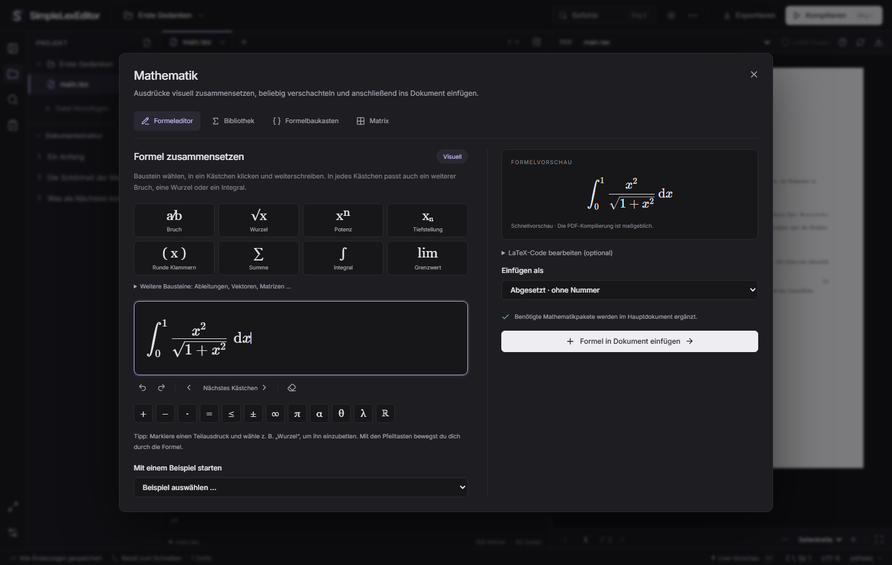

# SimpleLexEditor bedienen

## Das erste Projekt

Das erste Projekt wird unter **Dokumente/SimpleLexEditor/Erste Gedanken** angelegt. Danach öffnet SimpleLexEditor beim Start das zuletzt verwendete Projekt. Ein bestehendes Projekt wird über seinen Ordner geöffnet; `main.tex` oder eine Datei mit `\documentclass` wird als Hauptdokument erkannt. Unter Einstellungen lässt sich jede `.tex`-Datei als Hauptdokument wählen.

Ein vorhandenes Einstiegsprojekt aus Roxena kann am bisherigen Speicherort weiterverwendet werden. SimpleLexEditor liest auch die in `.roxena/` gespeicherten Entwürfe und Versionen bestehender Projekte.

## Funktionen

- Sieben Vorlagen: Forschungsartikel, Vorlesungsskript, Übungs-/Prüfungsblatt, Artikel, wissenschaftliche Arbeit, Brief und leeres Dokument.
- Mathematik-Palette mit 176 durchsuchbaren Formeln und Symbolen, Formelbaukasten, Matrix-Editor und direkter visueller Vorschau.
- Literaturverwaltung für `.bib`-Dateien, neue Quellen, Zitierbefehle und Literaturverzeichnisse mit BibTeX oder biblatex/Biber.
- BibTeX-Dateien lokal mit Importvorschau, Duplikaterkennung und unveränderten Originaleinträgen übernehmen. Mehrere Quellen gemeinsam mit Vorbemerkung und Seitenangaben zitieren; natbib und biblatex werden auch in eingebundenen Präambeln erkannt.
- Wissenschaftliche Projektprüfung für die ausgewählte Arbeit: fehlende und doppelte Labels, Zitatschlüssel, Dateieinbindungen, Bildpfade, offene Aufgaben und Beschriftungen prüfen. Der projektweite Index führt direkt zu Gleichungen, Sätzen, Beweisen, Abbildungen und Tabellen.
- Projektweite Label-Auswahl und Autovervollständigung für Zitatschlüssel, Querverweise und LaTeX-Umgebungen.
- Sätze, Lemmata, Propositionen, Korollare, Definitionen, Bemerkungen und Beweise mit amsthm. Benötigte Pakete werden im Hauptdokument ergänzt; eingebundene Präambeldateien werden berücksichtigt.
- Bestehende Projekte mit Unterordnern und Ressourcen öffnen; neue Dateien und Unterordner anlegen.
- Aufklappbare Ordnerstruktur mit Rechtsklick-Menüs: Dateien/Ordner erstellen, umbenennen/verschieben, im Dateimanager anzeigen, Pfade kopieren, Vorschau auswählen und reversibel in den Projektpapierkorb verschieben.
- CodeMirror mit LaTeX-Syntaxfarben, Autovervollständigung, Klammerhervorhebung, Suchen und Ersetzen sowie eigener Undo-Historie pro Dateitab.
- Einklappbare Dokumentstruktur mit direktem Sprung zu Abschnitten; projektweite Suche mit Groß-/Kleinschreibung, ganzen Wörtern, hervorgehobenen Treffern und genauer Quelltextauswahl. Offene Änderungen sind sofort durchsuchbar.
- Dateien per **Strg+P** anhand von Dateiname und Pfad öffnen. Das Befehlsmenü ist mit Pfeiltasten und Enter bedienbar. Offene Tabs, aktive Datei und Editoraufteilung werden wiederhergestellt.
- Einfügehilfen für Überschriften, Textformatierung, Formeln, Matrizen, Listen, Zitate, Verweise, Tabellen und Abbildungen. Bilder werden ins Projekt kopiert.
- Einstellbarer Compiler: pdfLaTeX, XeLaTeX, LuaLaTeX oder Tectonic. Automatische Mehrfachläufe für Verweise und bei Bedarf BibTeX/Biber.
- Automatische Kompilierung nach einer Schreibpause; manuelle Kompilierung jederzeit möglich. Bei Fehlern bleibt die letzte erfolgreiche PDF sichtbar. Live-LaTeX-Fehler werden im Status und an der Vorschau angezeigt, ohne beim Tippen das Problempanel oder eine Meldung einzublenden. Bei manuell gestarteten fehlerhaften Läufen öffnet sich das Problempanel weiterhin; dort stehen Fehler vor Warnungen.
- PDF-Vorschau mit markierbarem und kopierbarem Text, direkter Seiteneingabe, Zoom, Seitenbreite und ganzer Seite. Eine veraltete PDF oder die letzte erfolgreiche PDF bei Compilerfehlern wird ausdrücklich gekennzeichnet.
- **PDF → LaTeX:** Nach erfolgreicher Desktop-Kompilierung öffnet ein Klick auf PDF-Text oder eine Formel die passende Quelldatei und markiert die Stelle, auch in eingebundenen Kapiteln. **LaTeX finden** schaltet den Klickmodus um. Änderungen erfordern eine aktualisierte PDF.
- **Probleme und Protokoll (Strg+J):** Fehler, Warnungen und Satzhinweise getrennt filtern, zu verfügbaren Quellpositionen springen und vollständiges Compilerprotokoll kopieren. Häufige Meldungen erhalten konkrete Bearbeitungshinweise.
- **Alle Fehler automatisch beheben:** Ein Knopfdruck behebt bekannte eindeutige Ursachen über mehrere Compilerläufe hinweg und aktualisiert die PDF. Fehlender Dokumentbeginn, häufige Befehlsfehler, Pakete und weitere Syntaxprobleme werden berücksichtigt; Ausgangsfassungen bleiben im Versionsverlauf erhalten. Fortschritt, Abbruch und optionale Einzelprüfung sind im Dialog verfügbar. Unbekannte Ursachen halten den Ablauf mit einer Erklärung an. Umfang und Grenzen stehen in der [Compilerhilfe](COMPILER_HELP.md).
- Export als PDF, komplettes ZIP-Projekt, aktuelle Quelldatei oder sichtbare PDF-Seite als PNG.
- Automatisches Speichern, lokale Entwurfswiederherstellung, bis zu 20 Fassungen je Datei im Versionsverlauf sowie dauerhafte Entwürfe in `.roxena/recovery/` und Speichern beim Schließen der App.
- Heller, dunkler oder Systemmodus; Schriftgröße, Zeilenumbruch und Fokusmodus.
- Vollständig lokale Verarbeitung. Schriftarten, PDF-Renderer und Programmressourcen werden mitgeliefert.

## Arbeitsbereich einrichten

Die **Einstellungen** sind in **Arbeitsbereich** und **LaTeX & PDF** gegliedert. Darstellung, Schriftgröße, Zeilenumbruch und automatisches Speichern stehen auf der ersten Seite. Compiler, Hauptdokument, Zeitlimit und Installationsprüfung liegen auf der zweiten; ein eigener TeX-Ordner lässt sich unter „Erweiterte Compiler-Einstellungen“ festlegen. Ein Klick auf den Compiler in der Statusleiste öffnet direkt die passende Seite.

[Einstellungen in Dunkel](screenshots/einstellungen-dark.png) · [Hell](screenshots/einstellungen-light.png) · [Compiler-Einstellungen](screenshots/compiler-einstellungen.png)

Die rechte Kante der Seitenleiste lässt sich ziehen. Die Breite wird gespeichert und an kleinere Fenster angepasst. Bei fokussierter Trennlinie verändern die Pfeiltasten die Breite; ein Doppelklick stellt die Standardbreite wieder her. **Strg+K → Ansicht zurücksetzen** stellt die Standardaufteilung wieder her.

Über die Zahl neben den Dateitabs öffnest du die Übersicht **Geöffnete Dateien**. **Strg+P** durchsucht das ganze Projekt; im Dialog kannst du zwischen „Alle Dateien“ und „Geöffnet“ wechseln. Aktive Tabs werden automatisch in den sichtbaren Bereich gescrollt.

**Strg+K** öffnet das Befehlsmenü. Du kannst beispielsweise nach „PDF speichern“, „Quellen“ oder „Ansicht Standard“ suchen. Pfeiltasten wählen einen verfügbaren Befehl, Home/End den ersten/letzten; Enter führt ihn aus. Nicht verfügbare Aktionen bleiben als solche gekennzeichnet.

[Befehlsmenü ansehen](screenshots/befehle.png)

## Speichern und Wiederherstellen

Über **Strg+K → Versionsverlauf und Wiederherstellung** oder **⋯ → Versionsverlauf und Wiederherstellung** öffnest du die gesicherten Fassungen der aktiven Datei. Eine Wiederherstellung lädt den Text zunächst in den Editor; **Strg+S** übernimmt ihn in die Projektdatei. Wird eine offene Datei außerhalb von SimpleLexEditor geändert, lädt der Editor unveränderte Fassungen neu. Bei eigenen Änderungen kannst du beide Fassungen vergleichen und deine Arbeit als separate Datei sichern.

[Speicherkonflikt ansehen](screenshots/speicherkonflikt.png) · [Versionsverlauf ansehen](screenshots/versionsverlauf.png)

Die Installationserkennung erreichst du über **Strg+K → TeX-Installation prüfen** oder **Einstellungen → LaTeX & PDF**. Dort lassen sich auch ein eigener Werkzeugordner und das Compilerzeitlimit festlegen. Bei einem hängenden Compilerlauf steht eine Abbruchschaltfläche bereit.

## Dateistruktur und die richtige PDF-Vorschau

[Projektsuche ansehen](screenshots/projektsuche.png) · [Schnelles Öffnen ansehen](screenshots/dateisuche.png) · [Compilerdiagnose ansehen](screenshots/probleme.png)

Ein Linksklick auf einen Ordner klappt ihn auf oder zu. Ein **Rechtsklick auf Projekt, Ordner oder Datei** öffnet die passenden Aktionen. Das Menü ist auch mit **Umschalt+F10** erreichbar. Neue Dateien und Ordner aus einem Unterordner-Menü werden dort angelegt.

[Rechtsklick-Menü ansehen](screenshots/dateimenue.png) · [Vorschauhilfe ansehen](screenshots/vorschauhilfe.png) · [Separate Kapitelvorschau ansehen](screenshots/kapitelvorschau.png)

Beim Anlegen einer `.tex`-Datei wählst du:

- **Eigenständiges Dokument:** Ein vollständiges LaTeX-Gerüst wird angelegt. Mit der standardmäßig aktiven Option „Direkt in der Vorschau anzeigen“ wird diese Datei sofort zum Vorschaudokument.
- **Kapitel / Teildatei:** Die Datei enthält nur Inhalt. Auf Wunsch ergänzt SimpleLexEditor automatisch `\input{kapitel/datei}` vor dem Ende des aktuellen Hauptdokuments. Die Vorschau zeigt dann die ganze Arbeit.

Direkt über der PDF steht **„Vorschau aus“** mit dem tatsächlich kompilierten Dateinamen. Dort oder über **Rechtsklick → Als Vorschaudokument verwenden** wählst du eine andere Datei. Ein Tabwechsel allein ändert das Vorschaudokument nicht. Wenn du eine andere Datei bearbeitest, zeigt ein Hinweis über dem Code die Zuordnung und bietet „Diese Datei anzeigen“ an.

Eine Teildatei kann nicht ohne Dokumentgerüst kompiliert werden. SimpleLexEditor bietet dafür eine Erklärung und zwei Wege: in das bestehende Hauptdokument einbinden oder eine separate **`datei-vorschau.tex`** erstellen. Die separate Vorschau übernimmt die Präambel des aktuellen Hauptdokuments und lädt die Teildatei. Der Kapitelinhalt bleibt unverändert und kann weiterhin in der ursprünglichen Arbeit verwendet werden. Vorhandene Dateien werden dabei nicht überschrieben.

Beim Umbenennen werden offene Tabs und das ausgewählte Vorschaudokument mitgeführt. **Dateiverweise im LaTeX-Code werden nicht automatisch umgeschrieben**; das Dialogfenster weist darauf hin. Beim Entfernen werden Änderungen zuerst gespeichert und Einträge nach `.roxena/trash/` verschoben. Die letzte Entfernung lässt sich innerhalb der laufenden Sitzung per „Rückgängig“ oder über das Rechtsklick-Menü wiederherstellen. Auch nach einem Neustart bleiben die Dateien im Projektpapierkorb vorhanden und können im Dateimanager zurückgeholt werden. Beim Wiederherstellen werden vorhandene Einträge nicht überschrieben.

## Mathematik und wissenschaftliches Arbeiten

Über dem Code liegen **Mathematik** und **Wissenschaft**. Mit **Strg+M** öffnest du den visuellen Formeleditor: Brüche, Wurzeln, Potenzen und Integrale lassen sich durch anklickbare Kästchen beliebig verschachteln und vor dem Einfügen prüfen. Markierte Teilausdrücke können eingebettet werden; Rückgängig und die optionale LaTeX-Ansicht erleichtern das Bearbeiten. Bibliothek, Formelbaukasten und Matrix bleiben daneben verfügbar. In schmalen Editoransichten werden die Werkzeugleisten kompakter; weitere Formatierungen bleiben über „Einfügen“ erreichbar.

[Literaturverwaltung ansehen](screenshots/literatur.png) · [Einfügeauswahl dunkel](screenshots/einfuegen-dark.png) · [Einfügeauswahl hell](screenshots/einfuegen-light.png) · [Gleichnamige Tabs unterscheiden](screenshots/dateitabs.png)

- **Bibliothek:** Griechische Buchstaben, Operatoren, Mengen und Logik, Pfeile und Akzente, Analysis, lineare Algebra, Statistik und Gleichungssysteme. Formelkarten übernehmen einen Ausdruck; Symbole ergänzen ihn an der aktuellen Position im Formelfeld.
- **Formelbaukasten:** Brüche, Wurzeln, Integrale, Summen, Grenzwerte sowie gewöhnliche und partielle Ableitungen über benannte Felder zusammenstellen. Der LaTeX-Ausdruck bleibt frei editierbar.
- **Matrix:** Bis zu 10 × 10 Einträge mit sechs Klammerarten. Einträge dürfen selbst Formeln sein.
- **Einfügemodus:** Inline, abgesetzt, nummeriert mit optionalem Label oder als reiner Code. Bestehende Mathematikumgebungen werden nicht erneut umschlossen. Steht der Cursor in der Präambel oder hinter dem Dokumentende, wird vor `\end{document}` eingefügt.
- **Literatur:** Quellen nach Titel, Autor, Jahr und Schlüssel durchsuchen. Artikel, Bücher, Konferenzbeiträge und sonstige Quellen in einer `.bib`-Datei anlegen. Bei natbib werden `\citep` und `\citet`, bei biblatex `\parencite`, `\textcite` und `\autocite` angeboten.
- **Querverweise:** Projektlabels mit `\ref`, `\eqref`, `\pageref` oder `\autoref` einfügen. Doppelte Labels und Zitatschlüssel werden angezeigt.
- **Sätze & Beweise:** Strukturierte Aussagen und Beweise einfügen. Vorhandene `\newtheorem`-Definitionen werden beibehalten.
- **Dokument:** Abstract, Verzeichnisse, Anhang, Fußnoten, Quellcode, SI-Einheiten und manuelles Literaturverzeichnis. Tabellen lassen sich mit `booktabs` setzen.

Die Schnellvorschau verwendet lokal mitgeliefertes KaTeX. Eigene Makros und LaTeX-Pakete, die KaTeX nicht kennt, bleiben im Code möglich; deren vollständige Darstellung erfolgt über die echte PDF-Kompilierung. Einfügehilfen sind für `.tex`-Dateien vorgesehen. Änderungen am Kapitel und an der Hauptpräambel werden gemeinsam gespeichert. Rückgängig im Kapitel entfernt eine Paketergänzung im Hauptdokument nicht.

## Tastenkürzel

| Aktion                   | Tastenkürzel          |
| ------------------------ | --------------------- |
| Befehlsmenü              | Strg+K                |
| Datei schnell öffnen     | Strg+P                |
| Probleme / Protokoll     | Strg+J                |
| Alles speichern          | Strg+S                |
| Projekt öffnen           | Strg+O                |
| Neues Projekt            | Strg+N                |
| Kompilieren              | Strg+Enter            |
| Element einfügen         | Strg+I                |
| Mathematik-Palette       | Strg+M                |
| Suchen / Ersetzen        | Strg+F / Strg+H       |
| Fokusmodus               | Strg+Shift+F          |
| Rückgängig / Wiederholen | Strg+Z / Strg+Shift+Z |

## Technische Hinweise

Kompilierung läuft außerhalb des UI-Threads, mit standardmäßig 180 Sekunden pro Gesamtlauf (einstellbar bis 30 Minuten) und deaktiviertem Shell-Escape. Projektdateizugriffe werden auf den geöffneten Projektordner begrenzt; Pfadtraversierung und symbolische Verknüpfungen nach außerhalb werden abgewiesen. LaTeX selbst ist kein Sandbox-Format: Öffne und kompiliere vertrauenswürdige Projekte. Compiler und Pakete stammen standardmäßig aus der mitgelieferten TeX-Live-Umgebung. Fehlende eigene Klassen oder projektspezifische Schriften müssen zum Projekt gehören; beschädigte mitgelieferte Dateien lassen sich durch erneutes Ausführen des vollständigen Installers ersetzen.

Compiler-Ausgaben werden je Hauptdokument und Compiler in getrennten Arbeitsverzeichnissen erzeugt. Sicherungen werden vor dem Überschreiben angelegt; externe Änderungen lösen einen Fassungsvergleich aus. Compiler-Ausgaben, Sicherungen und temporäre Dateien liegen im ausgeblendeten Projektordner `.roxena/` und werden nicht in das Projekt-ZIP aufgenommen. PNG exportiert die gerade gerenderte Seite in der aktuellen Zoomauflösung. Die Vorschau kombiniert einen Canvas-Renderer mit einer Textschicht für Auswahl und Kopieren. Anklickbare PDF-Links und bidirektionales SyncTeX sind in dieser Version nicht implementiert. Extern geänderte offene Dateien werden anhand ihrer Dateimetadaten erkannt: unveränderte Editorfassungen werden neu eingelesen, bei eigenen Änderungen erscheint ein Fassungsvergleich; die Projektsuche hat zusätzlich eine Schaltfläche zum Aktualisieren ihres Index.

Offizielle technische Dokumentation: [Tauri](https://v2.tauri.app/), [CodeMirror](https://codemirror.net/docs/), [PDF.js](https://mozilla.github.io/pdf.js/).
